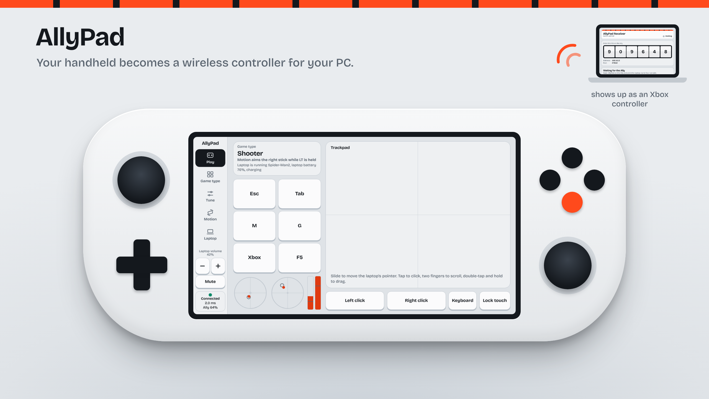
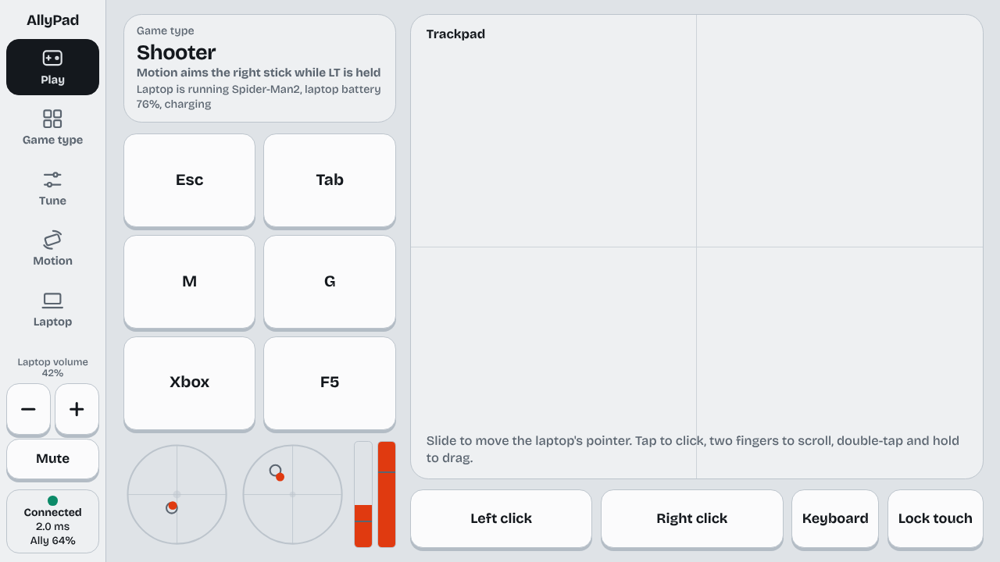

# AllyPad

Use a ROG Ally as a wireless controller for a Windows laptop, with a
touchscreen trackpad, motion controls and per-game-type tuning.

Two programs, no installer:

| File | Runs on | What it does |
|---|---|---|
| `allypad-receiver.exe` | the laptop | Shows a PIN, then turns what the Ally sends into a virtual Xbox 360 controller, mouse and keyboard |
| `allypad-sender.exe` | the Ally | Reads the Ally's controller, gyro and touchscreen and streams them to the laptop |

It runs over your Wi-Fi (or a USB-C network cable), not Bluetooth: Windows
cannot make a PC appear as a Bluetooth gamepad, and a local network link is
faster anyway.

## Set up

**Laptop, once**

1. The ViGEmBus driver is what lets games see a controller. The receiver
   window has an **Install driver** button: it runs a ViGEmBus installer
   placed next to `allypad-receiver.exe` if there is one, otherwise installs
   it with Windows' own `winget`, otherwise opens the download page
   (https://github.com/nefarius/ViGEmBus/releases). Without the driver the
   mouse, trackpad and touch keys still work.
2. Run `allypad-receiver.exe`. Windows SmartScreen will warn because the
   program is unsigned: choose **More info**, then **Run anyway**. It opens
   a small window showing the PIN, the connection and the input arriving.
3. On its first run it asks for administrator approval once, to add a
   Windows Firewall rule for its UDP port (47810). Without that rule the
   Ally cannot find or reach the laptop.
4. Note the six-digit PIN and the address in the window. The PIN stays
   the same between runs.

**Ally**

1. In Armoury Crate's Command Center set **Control Mode** to **Gamepad**.
   In Auto or Desktop mode the Ally turns its sticks into a mouse and
   AllyPad gets no controller input.
2. Run `allypad-sender.exe`. It opens a full-screen window (it uses
   Microsoft Edge to draw it; nothing is loaded from the internet).
3. Tap **Laptop**, pick your laptop from the list, enter the PIN.

The bottom-left corner shows the connection and the one-way delay.

## Screens

- **Play**: touchscreen trackpad, left and right click, six touch keys, live view of sticks and triggers.
- **Laptop volume** (bottom left, on every screen): minus, plus and Mute. Hold plus or minus to keep stepping.
- **Game type**: Standard, Shooter, Racing, Flight, Fighting and retro, Desktop, plus two custom slots. Each keeps its own settings.
- **Tune**: dead zones, response curves, sensitivity, hair triggers, button swaps, trackpad behaviour, touch-key assignments. **Reset** restores the game type's defaults.
- **Motion**: gyro aiming (to the right stick or to the mouse), tilt steering, tilt flying. **Recentre** takes your current grip as level; **Calibrate** removes gyro drift (hold still for two seconds).
- **Laptop**: connection, update rate (125 to 1000 per second), rumble strength, look, full screen, quit.

Trackpad gestures: slide to move, tap to click, two-finger tap to
right-click, two fingers to scroll, double-tap and hold to drag.

## More

- **Up to four players**: four Allys (or any PCs running the sender) can
  connect to one laptop; each becomes its own Xbox controller. The
  receiver window shows who is which player.
- **Several computers**: every computer you connect to is saved on the
  Laptop screen. Tap one to switch.
- **Lock touch** (Play screen): the screen ignores everything until you
  hold the unlock button, so a stray thumb cannot send mouse input.
- **Game linking** (Game type screen): when the laptop has a game in
  front, one tap makes the current game type switch on automatically
  whenever that game runs.
- **Turbo and toggle** (Tune, Buttons): per button. Toggle means one
  press turns it on and the next turns it off.
- **Back buttons** (Tune, Buttons): Windows cannot read the Ally's back
  buttons directly. In Armoury Crate set each to send a keyboard key
  (Scroll Lock and Pause are safe choices), pick the same keys in AllyPad,
  then choose what each does on the laptop.
- **Keyboard** (Play screen): a touch keyboard for the laptop with media
  keys, Screenshot (Win+PrtSc), Alt+Tab and Sleep. Shift, Ctrl, Alt and
  Win apply to the next key you tap.
- **Laptop status**: volume, battery and the game in front show on the
  Ally.
- **Ally battery**: shown bottom left, and on the lock screen.
- **Save power** (Laptop screen, on by default): while connected, the
  Ally's Windows power mode is set to Best power efficiency, and the
  screen dims to its minimum while touch is locked. Both go back when you
  disconnect, unlock or quit. It does not change Armoury Crate's own
  operating mode; set that to Silent yourself for the biggest saving.
- **Stays in the tray**: closing the receiver window keeps it running in
  the notification area by the clock. Click its icon to open the window
  again; right-click for Open and Quit.
- **Start with Windows** (receiver window): the receiver starts quietly at
  sign-in and keeps running when its window is closed. Run it again to
  see the window; use Quit to stop it.
- **Shortest delay**: see the note on the Laptop screen. A plain USB-C
  cable between two PCs does not make a network; it needs USB4 or
  Thunderbolt on both, otherwise use the laptop's hotspot or Ethernet.

Not included: a PlayStation controller mode. The controller library only
supports a basic DualShock 4 without gyro or touchpad, which would add
nothing over the Xbox controller.

## If something is off

- **Laptop not listed**: the receiver window should say the firewall rule
  is allowed; if it says Blocked, press **Allow** and approve the prompt. Both devices must also be on the same network. Guest
  Wi-Fi and some routers block device-to-device traffic; use **Type an
  address** with the address shown in the receiver window, or connect the
  Ally to the laptop's mobile hotspot.
- **"Wrong PIN"** after several tries locks new connections for a minute.
- **Controller does nothing in a game**: check ViGEmBus is installed and
  the Ally is in Gamepad mode. The Play screen shows a warning for both.
- **Motion goes the wrong way**: use the Flip switches on the Motion
  screen. If left/right aiming feels off, change **Turn by**.
- **Clicks ignored in an admin window**: Windows only lets a program
  control elevated windows if it is elevated too. Run the receiver as
  administrator.
- **Xbox button also opens Game Bar on the Ally**: the Ally still sees its
  own controller. That is expected.
- Sender log: `%APPDATA%\AllyPad\sender.log`. Settings live in the same
  folder; delete `sender.json` to start fresh.
- Receiver options: `--new-pin`, `--pin 123456`, `--no-firewall`, `--no-ui` (no window), `--background` (no window until you run it again). Its log is `%APPDATA%\AllyPad\receiver.log`.
- **Quit AllyPad** on the Laptop screen stops the app and closes its window. Closing the window stops the app too.

## Safety

The receiver accepts input only from a sender that knows the PIN, and
every packet is authenticated, but the link is not encrypted. Use it on
networks you trust (home Wi-Fi), not public ones.

## Build from source

Install Rust from https://rustup.rs, then in this folder:

    cargo build --release

The programs appear in `target\release`. `cargo test` runs the protocol,
receiver and input-shaping tests on any OS.

## Credits

- Virtual controller: ViGEmBus by Nefarius, via the `vigem-client` crate.
- Fonts (SIL Open Font License 1.1): Barlow Semi Condensed, Bricolage
  Grotesque, Chakra Petch.
